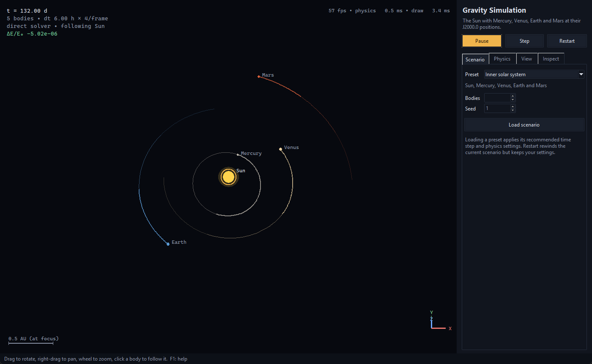
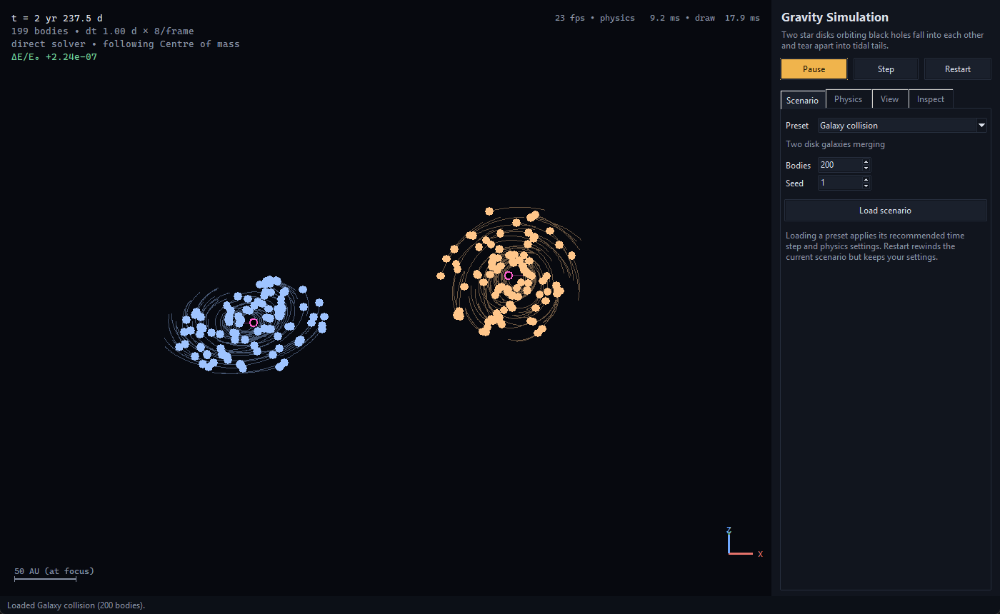

# Gravity Simulation

An interactive 3D gravitational N-body simulator: as accurate as practical, while still being fun to play with.

Watch the real solar system evolve from its J2000.0 configuration, explore a figure-eight three-body choreography, observe a star cluster ejecting members, or simulate two disk galaxies tearing each other into tidal tails. See the numerical error of the integration as it happens.

## Screenshots

### Inner Solar System



### Galaxy Collision



## Features

- **Accurate integration:** Kick-drift-kick leapfrog (velocity Verlet), which is symplectic and time-reversible, so energy errors stay bounded instead of growing. After one sidereal year (365.256 days), Earth returns within \(2 \times 10^{-5}\) AU of its starting position. The residual is real perturbation from the other planets.
- **Two force solvers:** An exact, vectorised direct sum and a **Barnes–Hut octree** with an adjustable opening angle \(\theta\). You can draw the octree over the scene.
- **Real initial conditions:** The planets start at their J2000.0 positions from JPL's approximate Keplerian elements. Other presets are a binary star, the figure-eight orbit, a virialised cluster, and a galaxy collision.
- **Collisions:** Bodies can merge (mass, momentum, centre of mass, and volume are conserved), bounce with a coefficient of restitution, or pass through each other. Black holes use their Schwarzschild radius.
- **Honest diagnostics:** The live relative energy error (\(\Delta E/E_0\)) appears in the overlay, with energy changes caused by collisions accounted for separately. The inspector also shows momentum, collision counts, and octree statistics.
- **Interactive 3D view:** Orbit, pan, and zoom the camera, click a body to follow it, and draw trails in the inertial frame or relative to the followed body. Bodies can be coloured by speed, acceleration, or mass.
- **Headless batch mode:** Run without a window, print diagnostics, and write a CSV.

## Quick Start

### Requirements

- Python 3.10 or newer.
- Tk support. It is included in the python.org installers; on Debian/Ubuntu, install `python3-tk`.

### 1. Create a virtual environment

```bash
python -m venv .venv
```

Activate it using the appropriate command for your operating system.

**Windows**

```bash
.venv\Scripts\activate
```

**macOS / Linux**

```bash
source .venv/bin/activate
```

### 2. Install the project

```bash
pip install -e ".[capture]"
```

The `capture` extra installs Pillow, which is only needed to save PNG screenshots or record frames.

### 3. Launch the simulator

```bash
gravity-sim
```

Alternatively:

```bash
python -m gravity_sim
```

### Useful Commands

Start the solar system preset:

```bash
gravity-sim --preset solar
```

Simulate a galaxy collision with 400 bodies and four steps per frame:

```bash
gravity-sim --preset galaxies --bodies 400 --steps-per-frame 4
```

Run the cluster preset using Barnes–Hut with an opening angle of 0.7:

```bash
gravity-sim --preset cluster --solver barnes-hut --theta 0.7
```

List all available presets:

```bash
gravity-sim --list-presets
```

For the complete list of options, including the time step, softening, collisions, fullscreen mode, frame recording, and headless mode, run:

```bash
gravity-sim --help
```

## Controls

| Input | Action |
|---|---|
| Left-drag | Rotate the view. |
| Right- or middle-drag | Pan. |
| Mouse wheel, `+` / `-` | Zoom. |
| Click a body | Select and follow it. Click empty space to deselect. |
| `Space` / `S` | Play–pause / single step. |
| `←` / `→` | Follow the previous / next body. |
| `Home` | Reset the camera. |
| `T` | Toggle trails. |
| `O` | Toggle the octree. |
| `C` | Toggle the centre-of-mass marker. |
| `L` | Toggle labels. |
| `H` | Toggle the overlay. |
| `F11` / `Esc` | Toggle / leave fullscreen. |
| `F1` or `?` | Show the controls overlay. |

### Side Panel

The side panel has four tabs:

- **Scenario:** Load a preset; the body count and seed apply to generated presets.
- **Physics:** Configure the time step, steps per frame, solver, \(\theta\), softening, collision mode, and restitution.
- **View:** Choose which body to follow, configure trails, toggle the octree overlay, change colouring and field of view, and export images.
- **Inspect:** View the selected body and system diagnostics.

**Restart** rewinds the scenario but keeps your settings. **Load scenario** applies the preset's recommended settings.

## Presets

| Key | Scenario | Bodies | Time Step |
|---|---|---:|---|
| `inner` | Sun, Mercury–Mars at J2000.0 | 5 | 6 h |
| `solar` | Sun and all eight planets at J2000.0 | 9 | 1 day |
| `binary` | Two stars (1.0 + 0.75 \(M_\odot\), 0.4 AU) with two circumbinary planets | 4 | 2.4 h |
| `figure8` | Chenciner–Montgomery figure-eight, three 1 \(M_\odot\) stars | 3 | 2.4 h |
| `cluster` | Virialised star cluster, masses 0.2–2 \(M_\odot\), softening 0.2 AU | 120 (2–2000) | 12 h |
| `galaxies` | Two disks of stars around 1000 \(M_\odot\) black holes, on a collision course | 200 (2–2000) | 1 day |

All presets start in the barycentric frame, with no net momentum. Generated presets are deterministic for a given `--seed`.

## Physics and Accuracy

### Units

Everything is calculated internally using SI units.

- Gravitational constant: \(G = 6.67430 \times 10^{-11}\), using CODATA 2018.
- Astronomical unit: \(1\ \mathrm{AU} = 1.495978707 \times 10^{11}\ \mathrm{m}\).
- Solar and planetary masses are defined from their measured GM values from JPL DE440.

The measured GM values are known about \(10^5\) times more precisely than \(G\) itself. Using them makes \(G \cdot m\) exact for the adopted values and produces accurate orbital periods. For planets, GM includes their moons.

### Integrator

Each integration step consists of a half-kick, a drift, a force evaluation, and a final half-kick.

A step that produces non-finite values is rolled back and reported. The GUI pauses with a message, and headless mode exits with code `3`.

The time step can be changed while running. Leapfrog stays accurate with a variable step but is then no longer strictly symplectic.

### Softening

An optional Plummer softening length \(\varepsilon\) replaces

\[
\frac{1}{r}
\quad\text{with}\quad
\frac{1}{\sqrt{r^2+\varepsilon^2}}
\]

in both the force and the potential, so energy is still conserved exactly by the softened force–potential formulation.

Changing \(\varepsilon\) changes the energy function, so the energy baseline resets.

### Force Solvers

The default `auto` solver selects the direct sum for up to 5,000 bodies.

The simulator supports:

- **Direct sum:** Exact pairwise force calculations, vectorised through NumPy.
- **Barnes–Hut:** Approximate force calculations using an octree and an adjustable opening angle \(\theta\).

The following measurements come from `scripts/benchmark_solvers.py` on the development machine. Times are in seconds per force evaluation.

| N | Direct (exact) | Barnes–Hut \(\theta=0.5\) | Barnes–Hut \(\theta=1.0\) | Barnes–Hut \(\theta=0.5\) RMS Error |
|---:|---:|---:|---:|---:|
| 100 | 0.0002 | 0.0058 | 0.0034 | 0.67% |
| 1,000 | 0.077 | 0.23 | 0.072 | 0.75% |
| 3,000 | 0.66 | 1.50 | 0.39 | 0.47% |
| 6,000 | 2.09 | 3.49 | 0.90 | 0.44% |

The direct sum runs inside NumPy's compiled loops, while the Barnes–Hut traversal is pure Python. Consequently, in this implementation, Barnes–Hut only beats the direct sum at loose opening angles or very large \(N\).

It is retained because it is the project's original algorithm, has genuine \(O(N\log N)\) complexity, and powers the octree overlay. With \(\theta=0\), it reproduces the direct sum exactly.

### Collisions

Collisions are detected when physical spheres overlap, using an \(O(N\log N)\) sort-and-sweep pass.

Three collision modes are available:

- **`merge`:** Every group of touching bodies becomes one body.
- **`bounce`:** An impulse is applied along the line of centres, with restitution \(e \in [0,1]\). Bodies are then separated without moving their centre of mass.
- **`off`:** Bodies pass through each other.

### Energy Accounting

Collisions intentionally change mechanical energy. Merging removes kinetic energy and also removes the pair's mutual potential energy, so the net change can have either sign.

This change is accumulated separately as *collision \(\Delta E\)*.

The displayed energy drift is calculated as:

\[
\frac{E+\Delta E_{\mathrm{collision}}-E_0}{|E_0|}
\]

This means the displayed drift measures numerical error after accounting for energy changes caused by collisions.

For more than 5,000 bodies under Barnes–Hut, the potential energy comes from the tree and is marked **approximate**.

### Body Sizes

Bodies are drawn exaggerated by default, with screen size proportional to radius raised to the power of 0.3:

\[
\text{screen size} \propto r^{0.3}
\]

This prevents planets from appearing as sub-pixel objects. Enable **True body scale** in the View tab to display physical sizes.

## Verification

The test suite in `tests/` checks physical invariants and numerical properties, not just whether the code executes.

### Orbits

- A circular orbit closes after one Kepler period.
- Energy error stays below \(10^{-6}\) over 20 orbits without secular growth.
- Momentum is conserved to round-off precision.
- Leapfrog is time-reversible.
- The first step introduces no spurious kick, fixing a legacy bug.

### Barnes–Hut

- \(\theta=0\) equals the direct sum.
- RMS errors stay below 0.5%, 2%, and 8% for \(\theta=0.3\), 0.5, and 1.0, respectively.
- The octree is correct for coincident bodies.

### Collisions

- Merges conserve mass, momentum, centre of mass, and volume.
- Elastic bounces conserve kinetic energy.
- Equal-mass bodies merge correctly, fixing a legacy bug.

### Presets

- J2000 Earth and Jupiter positions agree with known values.
- Earth completes its orbit after one sidereal year.
- The figure-eight system returns to its starting configuration after one period.
- The cluster is exactly virialised.
- Every preset runs stably.

### Interface

- Camera projection.
- Command-line behaviour, including exit codes and CSV output.
- GUI smoke tests that drive the real Tk window.

## Headless Mode

Run a simulation without opening a graphical window:

```bash
gravity-sim --headless --preset solar --steps 36525 --report-every 3652 --csv solar.csv
```

This prints a diagnostics table using ASCII-only output for compatibility with different consoles. It can also write a CSV file containing the simulation results.

### CSV Columns

The CSV contains the following columns:

- `step`
- `time_days`
- `bodies`
- `kinetic_J`
- `potential_J`
- `total_J`
- `collision_energy_J`
- `energy_drift`
- `momentum_kg_m_s`
- `angular_momentum`
- `collisions`
- `solver`

### Exit Codes

| Code | Meaning |
|---:|---|
| `0` | Success. |
| `2` | Invalid arguments. |
| `3` | Numerical instability. |

## Screenshot and Frame Capture

The simulator supports image export and frame recording.

- The `capture` installation extra provides Pillow for saving PNG screenshots and recording frames.
- PNG export and `--record` capture the screen region occupied by the canvas. The simulator window must therefore be **visible and in the foreground**.
- `.eps` export works without Pillow.

Install the capture dependency with:

```bash
pip install -e ".[capture]"
```

For the exact screenshot-export and recording options supported by the installed version, consult:

```bash
gravity-sim --help
```

This README preserves the original capture behaviour without inventing additional screenshot commands or unsupported command-line flags.

## Using the Engine as a Library

The physics core has no GUI dependency and can be imported directly into Python projects.

```python
from gravity_sim import Simulation, build_scenario

scenario = build_scenario("solar")
sim = Simulation(scenario.bodies, scenario.config)

sim.step(365)  # One year at dt = 1 day

print(sim.energy().drift)  # Relative energy error
print(sim.names, sim.pos / 1.496e11)  # Positions in AU
```

To create your own system, construct `gravity_sim.BodySpec` objects using SI units and provide a `SimulationConfig`.

## Development

Install the development and capture dependencies:

```bash
pip install -e ".[dev,capture]"
```

Run the test suite:

```bash
pytest
```

Run linting, formatting checks, and strict type checking:

```bash
ruff check . && ruff format --check . && mypy
```

### GUI Testing and CI

The GUI tests open a real Tk window and skip automatically when no display is available. On Linux CI, they run under `xvfb-run`.

GitHub Actions (`.github/workflows/ci.yml`) runs linting and strict mypy checks, then runs the tests on Linux, Windows, and macOS with Python 3.10 and 3.13, along with a headless smoke run.

### Project Layout

```text
gravity_sim/
  simulation.py  Integrator, collisions, energy bookkeeping, trails
  forces.py      Direct-sum and Barnes–Hut solvers
  octree.py      Barnes–Hut octree
  collisions.py  Overlap detection, merge and bounce response
  bodies.py      Validated body specifications
  presets.py     Built-in scenarios (JPL elements, figure-eight, ...)
  orbits.py      Kepler's equation, orbital elements -> state vectors
  camera.py      Orbit camera and perspective projection
  app.py         Tkinter interface
  cli.py         Command-line and headless mode

scripts/
  benchmark_solvers.py  Solver speed/accuracy comparison

legacy/                 Original implementation, unmodified
tests/                  Automated test suite
```

## Limitations

- **Newtonian gravity only:** There is no relativity, tides, radiation, or gas. Black holes are point masses with a Schwarzschild collision radius.
- **Fixed time step:** There are no adaptive or per-body time steps. Very close encounters need softening or a smaller `dt`. If a step produces non-finite values, the integrator stops and reports the problem.
- **Interactive speed:** Rendering on a Tk canvas stays interactive up to a few hundred bodies. The physics alone handles thousands, but the frame rate drops.
- **Approximate ephemeris:** The J2000 planetary elements are JPL's approximate set, valid from 1800 to 2050. "Earth" represents the Earth–Moon barycentre. The model is accurate to roughly arc-minutes, not an ephemeris replacement.
- **Platform caveats for image capture:** PNG export and `--record` capture the screen region of the canvas, so the window must be visible and on top. `.eps` export works without Pillow.

## Credits

- **Original Barnes–Hut gravity simulation:** Gerrit Fritz (PhySimdev). The original implementation is preserved in `legacy/`.
- **Planetary elements:** E. M. Standish, *Keplerian Elements for Approximate Positions of the Major Planets*, Jet Propulsion Laboratory (JPL).
- **Figure-eight solution:** A. Chenciner and R. Montgomery, *Annals of Mathematics*, Volume 152 (2000).

---

**Gravity Simulation** combines N-body gravitational dynamics, numerical integration, collision modelling, scientific diagnostics, and interactive visualisation in a single Python application.
